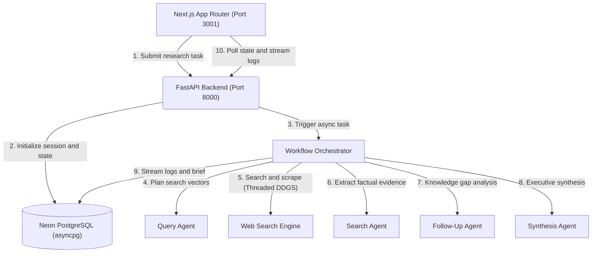

# Noesis

Autonomous multi-agent research and synthesis engine. Built with FastAPI, SQLModel, OpenAI Agents SDK, and Next.js 16.

## 1. Overview and Capabilities

* **Iterative Research Loop**: Deconstructs high-level queries into orthogonal vectors, runs targeted web research, evaluates knowledge gaps, and iterates until depth criteria are satisfied.
* **Multi-Agent Swarm**:
  * **Query Agent**: Plans diverse, orthogonal search queries from the primary prompt.
  * **Search Agent**: Scrapes and synthesizes web content into concise factual evidence.
  * **Follow-up Agent**: Evaluates accumulated findings against research goals to generate follow-up exploration paths.
  * **Synthesis Agent**: Produces an executive-level, citation-backed Markdown brief with structured sections, comparative tables, and strategic takeaways.
* **Next.js Workspace**:
  * Real-time polling agent event stream categorized by reasoning, queries, and scraped sources.
  * Reading time, word count, and structured brief synthesis.
  * Preset research prompts, scope estimation indicators, session history archive, one-click Markdown download, and shareable link generation.

## 2. Architecture



## 3. Technology Stack

| Layer | Technologies |
| :--- | :--- |
| **Backend** | Python 3.11+, FastAPI 0.162+, OpenAI Agents SDK, SQLModel 0.0.48+, asyncpg, Neon PostgreSQL, DuckDuckGo Search |
| **Frontend** | Next.js 16 (App Router), React 19, TypeScript 5.8+, Tailwind CSS 3.4, Lucide Icons, Canvas Confetti |
| **Tooling and Dev** | Nix Flakes with Direnv, UV package manager, Bun runtime, Pytest with Pytest-Asyncio, ESLint |

## 4. Getting Started

### Prerequisites

Clone the repository and enter the directory:

```bash
git clone git@github.com:Hetav21/Noesis.git
cd Noesis
```

If you use **Nix** and **direnv**, dependencies and library paths load automatically:
```bash
direnv allow
```

### Environment Configuration

Configure backend credentials:
```bash
cp backend/.env.example backend/.env
```
Ensure `OPENAI_API_KEY` is provided in `backend/.env`.

### Running Locally

#### 1. Backend (FastAPI on Port 8000)
```bash
cd backend
uv run uvicorn app.main:app --host 127.0.0.1 --port 8000 --reload
```
* Interactive API docs: `http://127.0.0.1:8000/docs`
* Health check: `http://127.0.0.1:8000/api/health`

#### 2. Frontend (Next.js on Port 3001)
```bash
cd frontend
bun install
PORT=3001 bun run dev
```
Open [http://localhost:3001](http://localhost:3001) in your browser.

## 5. API Reference

| Method | Endpoint | Description |
| :--- | :--- | :--- |
| `GET` | `/api/health` | Service status; does not check the database |
| `POST` | `/api/research` | Submit a new research task (`query`, `depth`, `breadth`) |
| `GET` | `/api/research` | List recent research sessions |
| `GET` | `/api/research/{id}` | Fetch session status, live logs, and synthesized result |
| `DELETE` | `/api/research/{id}` | Delete a research session and associated logs |
| `GET` | `/api/suggestions` | Fetch dynamic inquiry suggestions |

## 6. Testing

### Backend Tests
```bash
cd backend
uv run pytest
```

### Frontend Validation and Production Build
```bash
cd frontend
bun run lint
bun run build
```
