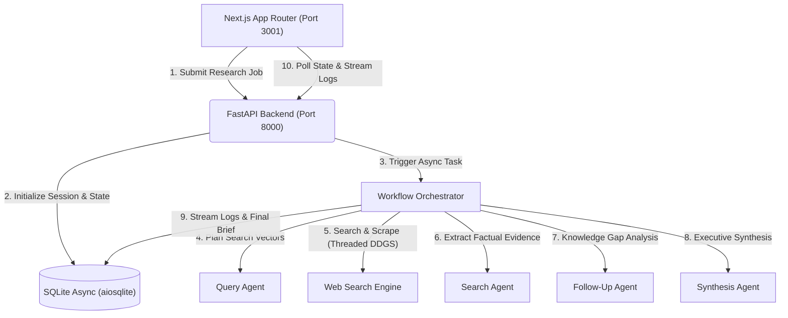

# Deep Research Agent

A high-performance, portfolio-grade autonomous research platform powered by a multi-agent workflow. Built with **FastAPI**, **SQLModel (Async SQLite)**, **OpenAI Agents SDK**, and a modern **Next.js 16 (App Router)** interface crafted with a refined, tactile aesthetic (Linear / Vercel design language).

---

## 1. Overview & Capabilities

* **Iterative Deep Research Loop**: Autonomous orchestration breaks user queries into targeted sub-questions, executes web research, evaluates knowledge gaps, and iterates until the configured depth is satisfied.
* **Specialized Multi-Agent Swarm**:
  * **Query Agent**: Deconstructs high-level queries into diverse, orthogonal web search queries.
  * **Search Agent**: Scrapes and synthesizes web content into concise factual evidence.
  * **Follow-up Agent**: Critically evaluates accumulated findings against research goals to generate intelligent follow-up exploration tracks.
  * **Synthesis Agent**: Produces an executive-level, citation-backed Markdown brief complete with structured sections, comparative tables, and strategic takeaways.
* **Tactile, Modern Next.js Workspace**:
  * Real-time polling agent event stream categorized by reasoning, queries, and scraped sources.
  * Dynamic reading time, word count, and table-of-contents extraction.
  * Preset research prompts, scope estimation indicators, session history archive, one-click Markdown download, and shareable link generation.
  * Native dark-mode palette, subtle border glows, monospace telemetry badges, and zero generic template clutter.

---

## 2. Architecture



---

## 3. Technology Stack

| Layer | Technologies |
| :--- | :--- |
| **Backend** | Python 3.11+, FastAPI 0.162+, OpenAI Agents SDK, SQLModel 0.0.48+, aiosqlite, DuckDuckGo Search |
| **Frontend** | Next.js 16 (App Router), React 19, TypeScript 5.8+, Tailwind CSS 3.4, Lucide Icons, Canvas Confetti |
| **Tooling & Dev** | Nix Flakes + Direnv, UV package manager, Bun runtime, Pytest + Pytest-Asyncio, ESLint |

---

## 4. Getting Started

### Prerequisites

Clone the repository and enter the directory:

```bash
git clone <repo-url>
cd deep-research-agent
```

If you use **Nix** and **direnv**, dependencies (Python 3.11, UV, Bun, Node 20, SQLite, Playwright driver) and library paths are loaded automatically:
```bash
direnv allow
```

### Environment Configuration

Configure backend credentials:
```bash
cp backend/.env.example backend/.env
```
Ensure `OPENAI_API_KEY` is provided in `backend/.env` (or available as an environment variable / `/run/secrets/openai_api_key`).

---

### Running Locally

#### 1. Backend (FastAPI — Port 8000)
```bash
cd backend
uv run uvicorn app.main:app --host 127.0.0.1 --port 8000 --reload
```
* Interactive API docs: `http://127.0.0.1:8000/docs`
* Health check: `http://127.0.0.1:8000/api/health`

#### 2. Frontend (Next.js — Port 3001)
```bash
cd frontend
bun install
PORT=3001 bun run dev
```
Open [http://localhost:3001](http://localhost:3001) in your browser.

---

## 5. API Reference

| Method | Endpoint | Description |
| :--- | :--- | :--- |
| `GET` | `/api/health` | Service health status and database liveness |
| `POST` | `/api/research` | Submit a new research task (`query`, `depth`, `breadth`) |
| `GET` | `/api/research` | List recent research sessions |
| `GET` | `/api/research/{id}` | Fetch session status, live logs, and synthesized result |
| `DELETE` | `/api/research/{id}` | Delete a research session and associated logs |

---

## 6. Testing & Quality Assurance

Both backend and frontend are strictly typed and covered by automated test suites.

### Backend Tests
```bash
cd backend
uv run pytest
```
Runs tests covering configuration fallback, agent initializations, schema validations, and full REST API endpoint lifecycles.

### Frontend Validation & Production Build
```bash
cd frontend
bun run lint
bun run build
```
Type checks all components, validates App Router metadata, and compiles optimized production assets.
