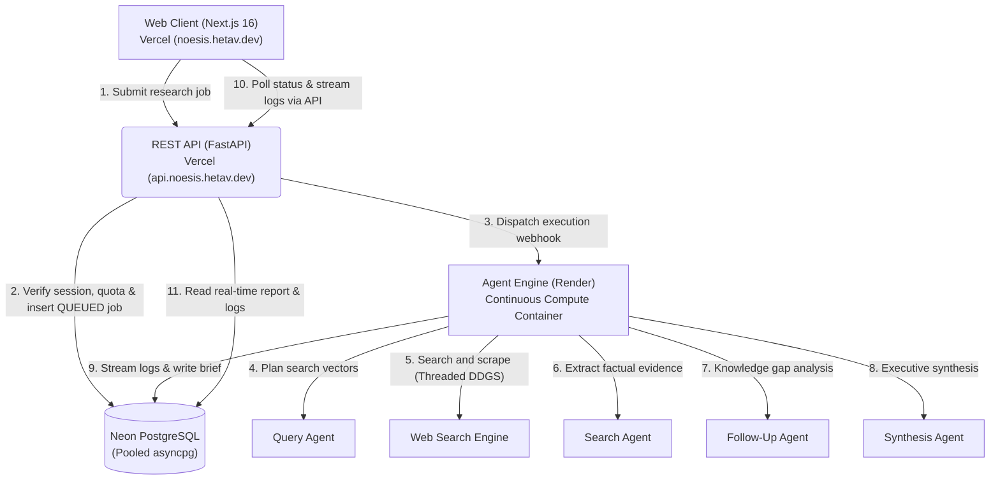

# Noesis

Autonomous multi-agent research and synthesis engine.

## 1. Overview and Capabilities

* **Iterative Research Loop**: Deconstructs high-level queries into orthogonal vectors, runs targeted web research, evaluates knowledge gaps, and iterates until depth criteria are satisfied.
* **Multi-Agent Swarm**:
  * **Query Agent**: Plans diverse, orthogonal search queries from the primary prompt.
  * **Search Agent**: Scrapes and synthesizes web content into concise factual evidence.
  * **Follow-up Agent**: Evaluates accumulated findings against research goals to generate follow-up exploration paths.
  * **Synthesis Agent**: Produces an executive-level, citation-backed Markdown brief with structured sections, comparative tables, and strategic takeaways.
* **Next.js Workspace**:
  * Real-time polling agent event stream categorized by reasoning, queries, and scraped sources.
  * Reading time, word count, and structured brief synthesis.
  * Preset research prompts, scope estimation indicators, session history archive, one-click Markdown download, and shareable link generation.

## 2. Distributed Architecture

Noesis is partitioned into three specialized services designed for low-latency delivery and reliable, long-running agent execution:



### Monorepo Structure

| Application | Path | Runtime | Hosting Target | Purpose |
| :--- | :--- | :--- | :--- | :--- |
| **`web`** | [`apps/web`](file:///home/hetav/Desktop/Code/deep-research-agent/apps/web) | Next.js 16, React 19, Bun | Vercel (`noesis.hetav.dev`) | Interactive research workspace and polling stream UI |
| **`api`** | [`apps/api`](file:///home/hetav/Desktop/Code/deep-research-agent/apps/api) | FastAPI, Python 3.11 | Vercel Serverless (`api.noesis.hetav.dev`) | Session isolation, rate limiting, job CRUD, dispatch gateway |
| **`agent`** | [`apps/agent`](file:///home/hetav/Desktop/Code/deep-research-agent/apps/agent) | Python 3.11, OpenAI Agents SDK | Render (Docker / Web Service) | Persistent multi-agent research pipeline and queue worker |

## 3. Technology Stack

| Layer | Technologies |
| :--- | :--- |
| **Web Client** | Next.js 16 (App Router), React 19, TypeScript 5.8+, Tailwind CSS 3.4, Lucide Icons |
| **REST API** | Python 3.11+, FastAPI 0.162+, SQLModel 0.0.48+, asyncpg, Neon PostgreSQL |
| **Agent Engine** | Python 3.11+, OpenAI Agents SDK, DuckDuckGo Search, BeautifulSoup4, asyncio |
| **Tooling & Dev** | Nix Flakes with Direnv, UV package manager, Bun runtime, Pytest with Pytest-Asyncio |

## 4. Getting Started Locally

### Prerequisites

Clone the repository and enter the directory:

```bash
git clone git@github.com:Hetav21/Noesis.git
cd Noesis
```

If you use **Nix** and **direnv**, dependencies and library paths load automatically:
```bash
direnv allow
```

### Environment Configuration

Configure environment variables for each service:

```bash
# 1. API Configuration
cp apps/api/.env.example apps/api/.env

# 2. Agent Configuration
cp apps/agent/.env.example apps/agent/.env

# 3. Web Configuration
cp apps/web/.env.example apps/web/.env.local
```

Ensure `DATABASE_URL` (Neon PostgreSQL) and `OPENAI_API_KEY` are provided.

### Running Locally

#### 1. Agent Engine (Render service on Port 8001)
```bash
cd apps/agent
uv run uvicorn app.main:app --host 127.0.0.1 --port 8001 --reload
```

#### 2. REST API (Vercel API service on Port 8000)
```bash
cd apps/api
AGENT_SERVICE_URL=http://localhost:8001 uv run uvicorn app.main:app --host 127.0.0.1 --port 8000 --reload
```
* Interactive API docs: `http://127.0.0.1:8000/docs`
* Health check: `http://127.0.0.1:8000/api/health`

#### 3. Web Workspace (Next.js on Port 3001)
```bash
cd apps/web
bun install
BACKEND_URL=http://localhost:8000 PORT=3001 bun run dev
```
Open [http://localhost:3001](http://localhost:3001) in your browser.

## 5. Deployment Guide

### Deploying `web` to Vercel
1. Set Root Directory to `apps/web`.
2. Add environment variable:
   * `BACKEND_URL=https://api.noesis.hetav.dev`
3. Configure custom domain: `noesis.hetav.dev`.

### Deploying `api` to Vercel
1. Set Root Directory to `apps/api`.
2. Framework Preset: **Other**.
3. Add environment variables:
   * `DATABASE_URL` (Neon PostgreSQL asyncpg URL)
   * `SESSION_SECRET` (Cryptographically random HMAC secret)
   * `OPENAI_API_KEY` (OpenAI key for query suggestions)
   * `AGENT_SERVICE_URL` (URL of deployed Render agent service)
   * `AGENT_INTERNAL_SECRET` (Secret token matching Render agent service)
4. Configure custom domain: `api.noesis.hetav.dev`.

### Deploying `agent` to Render
1. Create a new **Web Service** on Render connected to this repository.
2. Root Directory: `apps/agent`.
3. Runtime: **Docker** (uses [`apps/agent/Dockerfile`](file:///home/hetav/Desktop/Code/deep-research-agent/apps/agent/Dockerfile)).
4. Add environment variables:
   * `DATABASE_URL` (Neon PostgreSQL asyncpg URL)
   * `OPENAI_API_KEY` (OpenAI API key)
   * `AGENT_INTERNAL_SECRET` (Secret token matching Vercel REST API)
   * `ENABLE_QUEUE_POLLER=true`

## 6. Testing

### Run REST API Tests
```bash
cd apps/api
uv run pytest
```

### Run Agent Tests
```bash
cd apps/agent
uv run pytest
```

### Run Web Validation and Build
```bash
cd apps/web
bun run lint
bun run build
```
