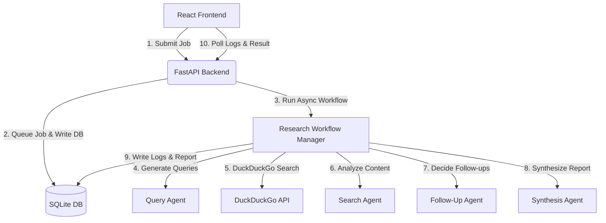

# Deep Research Agent V2

A web application that implements an iterative deep research workflow using a multi-agent system. It allows users to input a query, specify search depth and breadth, track the agent logs in real time, and view a synthesized final markdown report.

---

## 1. Project Details & Features

* **Iterative Research Workflow**: The backend generates search queries based on the user's initial input, scrapes search results, analyzes them, and dynamically decides if further follow-up queries are needed (up to a configured depth limit).
* **Multi-Agent System**: Utilizes specialized agents for query analysis, content summary, follow-up decisions, and final report synthesis.
* **Real-Time Log Stream**: Polling interface showing live step-by-step progress of the research agents.
* **Configurable Scope**: Allows setting the search **depth** (number of iterative research rounds) and **breadth** (number of search results to crawl per query).

---

## 2. Start Commands

### Prerequisites & Environment Setup
Ensure you set your OpenAI API key (used by the OpenAI Agents SDK):
```bash
export OPENAI_API_KEY="your-openai-api-key"
```

If you use Nix and `direnv`, running the following command in the project root will automatically load the correct versions of Python, Bun, SQLite, UV, and Node:
```bash
direnv allow
```

### Starting the Services

#### Backend (FastAPI - Port 8000)
1. Navigate to the backend directory:
   ```bash
   cd backend
   ```
2. Start the server (runs SQLite initialization on startup):
   ```bash
   uv run uvicorn app.main:app --reload
   ```

#### Frontend (React + Vite - Port 5173)
1. Navigate to the frontend directory:
   ```bash
   cd frontend
   ```
2. Install dependencies:
   ```bash
   bun install
   ```
3. Start the dev server:
   ```bash
   bun dev
   ```

---

## 3. Architecture



### Backend
* **FastAPI**: Exposes `/api/research` endpoints for creating and fetching job status/logs.
* **SQLModel & aiosqlite**: Provides asynchronous SQLite database access for storing and retrieving research job states.
* **OpenAI Agents SDK**: Orchestrates the agent group (`gpt-4o-mini` by default):
  * **Query Agent**: Breaks down research goals into targeted search queries.
  * **Search Agent**: Extracts and summarizes content from search results.
  * **Follow-up Agent**: Evaluates if the current findings are sufficient or if more research is required.
  * **Synthesis Agent**: Compiles all findings into a final cohesive markdown report.

### Frontend
* **Vite + React 19 + TypeScript**: Fast frontend compilation and strict type safety.
* **React Router v7**: Configured with `createBrowserRouter` to handle routing between the Homepage (form submission) and the Research details view.
* **Tailwind CSS v4**: Utility-first CSS framework for styling.
