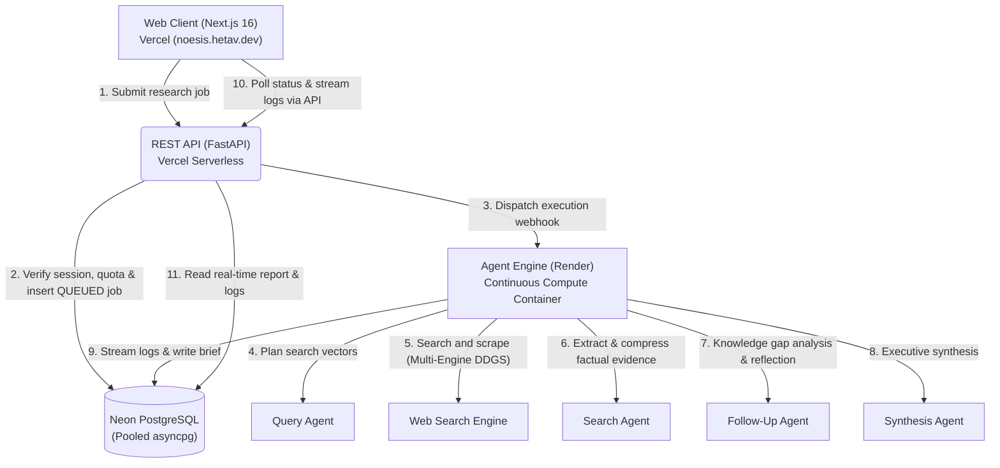

# Noesis

> **Autonomous multi-agent research and synthesis engine.**
>
> *Deconstructs complex inquiries, navigates multi-source web investigations with recursive self-reflection, and synthesizes citation-backed executive briefs in real time.*

[](https://github.com/Hetav21/Noesis/actions/workflows/ci.yml)
[](https://noesis.hetav.dev)
[](https://coderabbit.ai)
[](LICENSE)

**Noesis** is a full-stack, autonomous multi-agent deep research platform. Unlike standard single-turn LLM search wrappers that perform shallow snippet matching across top results, Noesis executes an iterative, self-evaluating research loop: deconstructing prompts into orthogonal search vectors, scraping and condensing dozens of primary web sources, running knowledge-gap critique rounds, and synthesizing executive-level briefs with verbatim citations.

---

## Key Capabilities

* **Recursive 4-Agent Research Swarm:**
  * **Query Agent (Planner):** Deconstructs open-ended queries into diverse, orthogonal search trajectories.
  * **Search Agent (Scraper & Analyzer):** Dispatches multi-engine search queries across DuckDuckGo, Brave, Yahoo, Startpage, and Mojeek with automated rate-limit fallbacks, extracting and condensing raw HTML into factual evidence nuggets.
  * **Follow-up Agent (Critic):** Evaluates accumulated findings against research objectives after each round, identifying knowledge gaps to initiate targeted follow-up queries or trigger early convergence.
  * **Synthesis Agent (Synthesizer):** Compiles an executive Markdown brief structured with key takeaways, deep dives, comparative tables, and hyperlinked citations.
* **Map-Reduce Context Compression:** Condenses raw web pages into 2–3 paragraph evidence summaries before context ingestion, enabling deep research across up to 60 distinct web sources per run without context window overflow.
* **Brokerless Asynchronous Coordination:** Orchestrates 5–10 minute research workflows using PostgreSQL for durable queuing (`SELECT ... FOR UPDATE SKIP LOCKED`), transactional concurrency serialization (`pg_advisory_xact_lock`), and adaptive client polling (1.8s interval with backoff)—eliminating external Redis or Celery dependencies.
* **Modern Next.js Workspace:** Features real-time agent reasoning event logs, reading metrics, word counts, scope estimation indicators, session history archives, one-click Markdown downloads, and shareable public links.
* **Reproducible Developer Environment:** Declarative toolchain management via Nix Flakes and `direnv` with Python 3.11, `uv`, Bun, PostgreSQL, and Playwright drivers pre-configured.

---

## Distributed Architecture

Noesis is partitioned into three specialized services designed for low-latency delivery, serverless edge handling, and persistent background compute:



### Monorepo Structure

| Service | Directory | Stack | Hosting Target | Purpose |
| :--- | :--- | :--- | :--- | :--- |
| **`web`** | [`apps/web`](apps/web) | Next.js 16, React 19, TypeScript, Tailwind CSS, Bun | Vercel (`noesis.hetav.dev`) | Interactive research workspace and polling stream UI |
| **`api`** | [`apps/api`](apps/api) | Python 3.11, FastAPI, SQLModel, asyncpg | Vercel Serverless | Session isolation, rate limiting, job CRUD, and webhook gateway |
| **`agent`** | [`apps/agent`](apps/agent) | Python 3.11, OpenAI Agents SDK, BeautifulSoup4, Docker | Render Web Service | Persistent multi-agent research pipeline and queue poller |

---

## Technology Stack

| Layer | Technologies & Components |
| :--- | :--- |
| **Web Frontend** | Next.js 16 (App Router), React 19, TypeScript 5.8+, Tailwind CSS 3.4, Lucide Icons, Bun |
| **API & State Gateway** | Python 3.11+, FastAPI 0.162+, SQLModel 0.0.48+, asyncpg, PgBouncer, Neon Serverless PostgreSQL |
| **Agent Pipeline** | OpenAI Agents SDK, DuckDuckGo Search (DDGS), BeautifulSoup4, asyncio, Docker |
| **Development & Tooling** | Nix Flakes, `direnv`, UV package manager, Bun runtime, Pytest, Ruff |

---

## Getting Started Locally

### Prerequisites

* [Git](https://git-scm.com/)
* Either [Nix](https://nixos.org/) with [direnv](https://direnv.net/) *(recommended)*, or standalone installations of [uv](https://docs.astral.sh/uv/) and [Bun](https://bun.sh/).

Clone the repository and enter the directory:

```bash
git clone git@github.com:Hetav21/Noesis.git
cd Noesis
```

If using Nix and direnv, allow the environment to load dependencies and system libraries automatically:

```bash
direnv allow
```

### Environment Configuration

Copy the example environment configurations for each service:

```bash
# 1. API Service
cp apps/api/.env.example apps/api/.env

# 2. Agent Service
cp apps/agent/.env.example apps/agent/.env

# 3. Web Service
cp apps/web/.env.example apps/web/.env.local
```

Ensure `DATABASE_URL` (Neon PostgreSQL asyncpg connection string) and `OPENAI_API_KEY` are provided in both `apps/api/.env` and `apps/agent/.env`.

### Running the Services

#### 1. Agent Engine (Render service on Port 8001)

```bash
cd apps/agent
uv run uvicorn app.main:app --host 127.0.0.1 --port 8001 --reload
```

#### 2. REST API (Vercel API service on Port 8000)

```bash
cd apps/api
AGENT_SERVICE_URL=http://localhost:8001 uv run uvicorn app.main:app --host 127.0.0.1 --port 8000 --reload
```

* **Interactive OpenAPI docs:** [http://127.0.0.1:8000/docs](http://127.0.0.1:8000/docs)
* **Health Check endpoint:** [http://127.0.0.1:8000/api/health](http://127.0.0.1:8000/api/health)

#### 3. Web Workspace (Next.js on Port 3001)

```bash
cd apps/web
bun install
BACKEND_URL=http://localhost:8000 PORT=3001 bun run dev
```

Open [http://localhost:3001](http://localhost:3001) in your browser.

---

## Production Deployment

### 1. Web Client (`apps/web`) → Vercel
1. Set **Root Directory** to `apps/web`.
2. Configure Environment Variable:
   * `BACKEND_URL`: URL of the deployed REST API service
3. Link custom domain: `noesis.hetav.dev`.

### 2. REST API (`apps/api`) → Vercel Serverless
1. Set **Root Directory** to `apps/api`.
2. Framework Preset: **Other**.
3. Configure Environment Variables:
   * `DATABASE_URL`: Neon PostgreSQL asyncpg connection URL
   * `SESSION_SECRET`: Cryptographically secure HMAC secret
   * `OPENAI_API_KEY`: OpenAI API key
   * `AGENT_SERVICE_URL`: URL of the deployed Render agent service
   * `AGENT_INTERNAL_SECRET`: Shared secret token matching the agent service

### 3. Agent Engine (`apps/agent`) → Render
1. Create a new **Web Service** on Render connected to this repository.
2. Set **Root Directory** to `apps/agent`.
3. Set **Runtime** to **Docker** (references [`apps/agent/Dockerfile`](apps/agent/Dockerfile)).
4. Configure Environment Variables:
   * `DATABASE_URL`: Neon PostgreSQL asyncpg connection URL
   * `OPENAI_API_KEY`: OpenAI API key
   * `AGENT_INTERNAL_SECRET`: Shared secret token matching Vercel REST API
   * `ENABLE_QUEUE_POLLER`: `true`

---

## Testing & Quality

### Run REST API Tests
```bash
cd apps/api
uv run pytest
```

### Run Agent Tests
```bash
cd apps/agent
uv run pytest
```

### Run Web Validation & Build
```bash
cd apps/web
bun run lint
bun run build
```

---

## Contributing

Contributions and feedback are welcome! Feel free to open issues or submit pull requests for bug fixes, performance improvements, or new features.

1. Fork the repository
2. Create your feature branch (`git checkout -b feat/amazing-feature`)
3. Commit your changes (`git commit -m 'feat: add amazing feature'`)
4. Push to the branch (`git push origin feat/amazing-feature`)
5. Open a Pull Request

---

## License

MIT License — see the [LICENSE](LICENSE) file for details.

---

## Acknowledgments

* [OpenAI Agents SDK](https://github.com/openai/openai-agents-python) — Multi-agent orchestration framework
* [FastAPI](https://fastapi.tiangolo.com/) — High-performance Python async web framework
* [Next.js](https://nextjs.org/) — React framework for the web
* [Neon PostgreSQL](https://neon.tech/) — Serverless Postgres platform
* [DuckDuckGo Search (DDGS)](https://github.com/deedy5/duckduckgo_search) — Python search engine client
